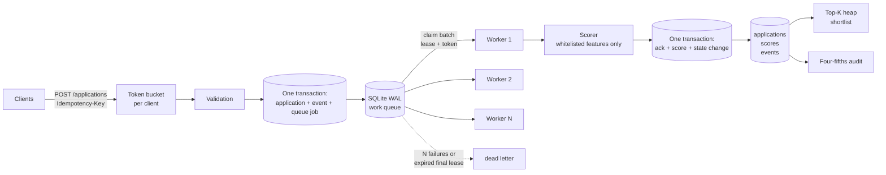

# hvh-selection-engine

A high-volume, automated candidate selection pipeline in pure Python (standard library only).

Applications come in through an HTTP API, wait in a durable queue, get an explainable score from worker
threads, move through an enforced lifecycle, and are ranked into a top-K shortlist per job. A fairness audit
then checks the outcome with the four-fifths (80%) rule.

The point of the project is the engineering underneath: idempotent ingestion, a crash-safe work queue,
concurrency that is proven correct by tests, measured performance, and honest trade-offs.

**All data is synthetic. The scoring rules and jobs are fictional examples. The fairness audit is a screening
heuristic, not legal advice.**

## What it shows

| Concern | How it is handled | Proof |
|---|---|---|
| Retried requests | `Idempotency-Key` + `UNIQUE(client_id, key)`; a different body with the same key is refused (409) | `tests/test_idempotency.py` (incl. 16 concurrent identical requests -> 1 row) |
| Abuse / overload | Per-client token bucket, `429` + `Retry-After`, bounded client map | `tests/test_ratelimit.py`, `tests/test_api.py` |
| Lost work | Application, history event and queue job commit in one transaction (transactional outbox) | `tests/test_idempotency.py`, `tests/test_crash_recovery.py` |
| Worker crashes | Leases (visibility timeout) + lease tokens; expired leases are reclaimed | Random crashes, a zombie worker, and a hard-killed OS process: `tests/test_crash_recovery.py` |
| Double scoring | Ack + score + state change in one transaction; score table keyed by application | Same tests check every application is screened exactly once |
| Bad jobs | Exponential backoff with jitter, dead-letter after N attempts, poison-message detection | `tests/test_work_queue.py` |
| Explainability | Every score has a per-factor breakdown with a sentence for each factor | `tests/test_scoring.py` |
| Protected attributes | Scorer only receives whitelisted features; randomized test changes name, email and demographics 1,500 times and the score never moves | `tests/test_scoring.py` |
| Lifecycle | `applied -> screened -> assessed -> shortlisted/rejected`, compare-and-set updates, append-only history enforced by SQL triggers | `tests/test_state_machine.py` |
| Ranking | Heap top-K, O(n log k) time, O(k) memory, stable ties | 500 randomized trials vs `sorted()`, comparison counting: `tests/test_ranking.py` |
| Fairness | Four-fifths rule by group, plain-English explanation, small-sample warning | `tests/test_fairness.py` (detects a biased upstream signal the scorer never saw) |

89 unit tests, all passing, on Windows with Python 3.13. CI runs them on Python 3.11, 3.12 and 3.13.

## 60-second quickstart

No installs needed. You need Python 3.11 or newer.

```powershell
git clone <this repo>
cd hvh-selection-engine

# Run the whole story end to end (about 10 seconds)
python -m hvh demo

# If "python" is not on your PATH (Windows), use the full path to python.exe, for example:
C:\Users\<you>\AppData\Local\Programs\Python\Python313\python.exe -m hvh demo

# Run the tests
python -m unittest discover -v
```

Other commands (all accept `--db <file>`, default `hvh.db`):

```powershell
python -m hvh seed --apps 10000 --fresh          # load synthetic applications, then score them
python -m hvh shortlist --job sde-l4-hvh --top 20 # preview the top 20 (add --commit to apply)
python -m hvh audit --job sde-l4-hvh --attribute gender --stage screening
python -m hvh serve --port 8080 --workers 4      # HTTP API on 127.0.0.1 only
python -m hvh bench                              # full benchmark, 100,000 applications (about 5 minutes)
python scripts/smoke_http.py                     # starts the server and calls every endpoint
```

Try the API by hand while `serve` runs:

```powershell
curl.exe -s -X POST http://127.0.0.1:8080/applications `
  -H "Content-Type: application/json" -H "Idempotency-Key: my-first-key" -H "X-Client-Id: me" `
  -d '{"job_id":"sde-l4-hvh","candidate":{"name":"Test Person","email":"test@example.com","skills":["python","sql","aws"],"years_experience":3,"assessment_score":80}}'
curl.exe -s http://127.0.0.1:8080/applications/<id from the response>
curl.exe -s http://127.0.0.1:8080/metrics
```

## Architecture



Everything lives in one SQLite file in WAL mode. The tables are `applications`, `self_identification`
(kept apart; only the audit reads it), `scores`, `events` (append-only) and `queue`.

## Benchmark (real numbers)

Measured with `python -m hvh bench` on 100,000 synthetic applications (seed 7).
Machine: AMD Ryzen 5 PRO 8540U (12 logical CPUs), 31.3 GB RAM, Windows 11, Python 3.13.5, SQLite 3.49.1.
Full output: [`docs/benchmarks/results.md`](docs/benchmarks/results.md).

| Phase | Workers | Items | Seconds | Items/sec | p50 ms | p95 ms | p99 ms |
|---|---|---|---|---|---|---|---|
| Ingestion, in-process (1 thread, 1 transaction per app) | - | 100,000 | 105.79 | 945 | 0.638 | 1.34 | 10.846 |
| Ingestion, HTTP (8 keep-alive clients) | - | 5,000 | 8.11 | 616 | 1.16 | 17.372 | 137.553 |
| Scoring (batches of 32, claim to commit) | 1 | 100,000 | 29.18 | 3,427 | 5.196 | 10.712 | 59.997 |
| Scoring | 2 | 100,000 | 26.77 | 3,735 | 5.772 | 39.371 | 110.544 |
| Scoring | 4 | 100,000 | 25.93 | 3,857 | 5.609 | 69.485 | 276.595 |
| Scoring | 8 | 100,000 | 30.92 | 3,234 | 7.061 | 117.248 | 1042.02 |
| End to end (ingest and score at the same time; created to scored) | 4 | 100,000 | 130.97 | 764 | 64.182 | 315.606 | 482.154 |

Each scoring and end-to-end run checks itself: queue `done` = score rows = `screened` events = 100,000.

What the numbers say:

* **More threads barely help.** Going from 1 to 4 workers adds about 13% throughput; 8 is slower than 1.
  SQLite allows one writer at a time and Python threads share one interpreter lock (the GIL), so extra
  threads mostly wait. Tail latency grows with every thread because they queue for the write lock.
  The fix at scale is more *processes* on *partitioned* data, not more threads.
* **Ingestion is bounded by commits.** About 1 ms per transaction. Batched commits are about 12x faster:
  `seed` loads 100,000 applications in 8.4 s (about 11,900/s) through the same validation and idempotency code.
  The API cannot batch without delaying each response.
* **End-to-end latency is mostly queue wait,** because ingestion and scoring compete for the same write lock.
* Numbers vary from run to run on a laptop (power state, background load). Rerun `python -m hvh bench` to
  measure your own machine.

## Limitations (stated honestly)

* Single node, single SQLite file. It is a design for one machine. Nothing here runs on AWS.
* No authentication. `X-Client-Id` is trusted as the client identity, which is fine for a local demo only.
* Leases are fixed length with no heartbeat, so a job slower than its lease could be processed twice.
  The atomic ack still prevents a double *score*, but the work is wasted.
* Idempotency keys are stored forever; a real service would expire them (for example after 24 hours).
* The rate limiter lives in process memory, so two API processes would each allow the full rate.
* The scoring rules are deliberately simple and fictional. Real selection criteria must be validated as
  job-related, and real fairness review needs proper statistics and legal input.
* Python 3.11 and 3.12 are covered by CI configuration; local runs were on 3.13.

## License

MIT, copyright Money Chanalia. See [LICENSE](LICENSE).
